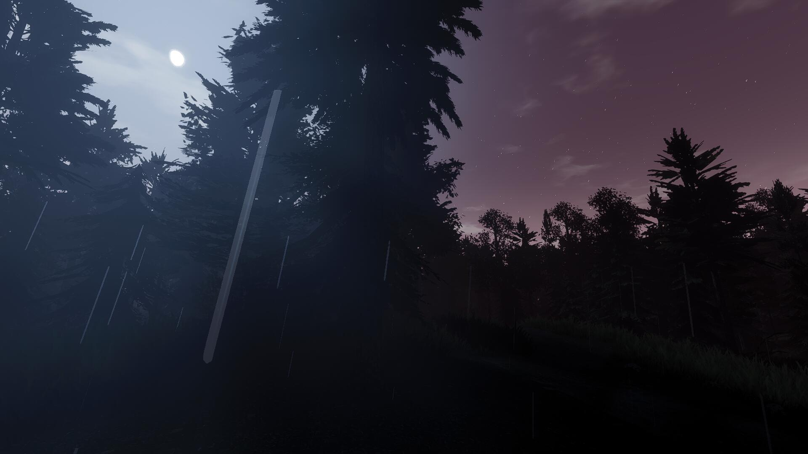
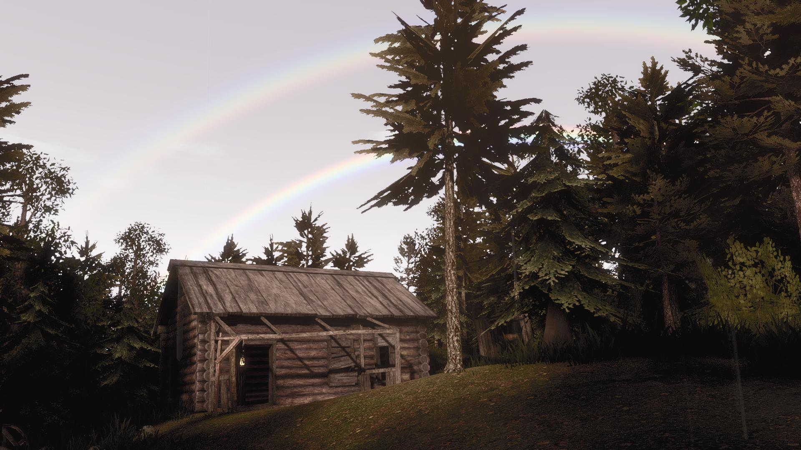
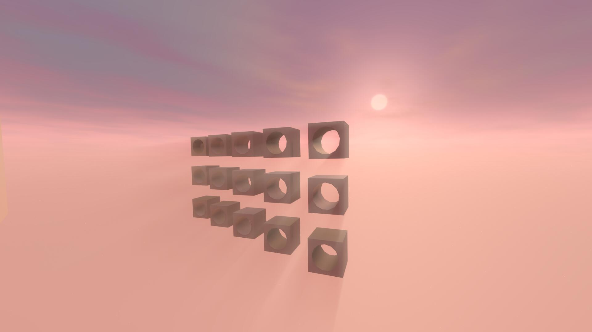
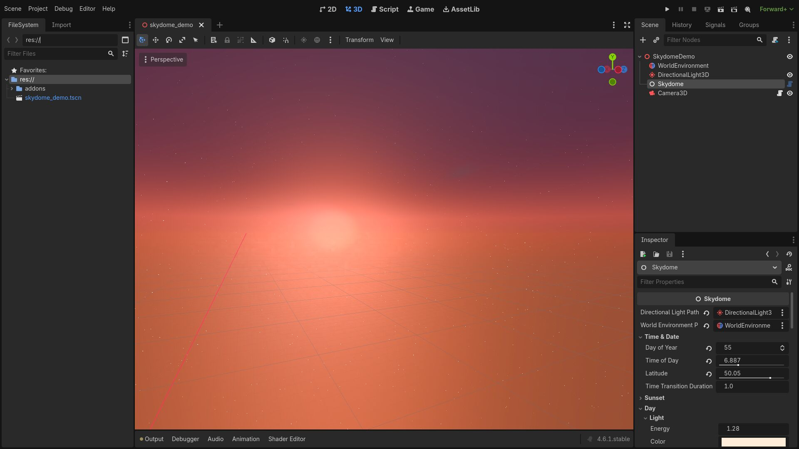

# Godot Skydome

## Features

* time of the day
* day of the year
* sun and moon discs
* stars
* clouds
* rainbow
* atmosphere scattering
* screen space lightshafts (for sun and moon)
* environment control (light, fogs)

## Assumptions

* artistic appearance over physical correctness
* as low gpu cost as possible
* ease of use
* part of bigger ecosystem

## Usage

* Add Skydome node to the 3D scene
* Add DirectionalLight3D and WorldEnvironment
* Create Environment in WorldEnvironment
* Setup Skydome's paths to DirectionalLight3D and WorldEnvironment
* Enable the plugin: it adds the `SkydomeServer` autoload

## The server and the node

`SkydomeServer` (an autoload) draws the skies, each by its RID, as `RenderingServer` keeps the
lights a `Light3D` sets: a `SkydomeSky` per RID, bound to a `WorldEnvironment` and a light
(`skydome_bind()`), with its parameters set by name (`skydome_set_param(rid, name, value)`).

The `Skydome` node is the sky in the scene: it keeps the parameters it is tuned with in the inspector,
saved with the scene, and sets them on its sky (`get_rid()`). What a game and its weather set as they
go they set on the sky past the node - `SkydomeServer.skydome_set_param()`, or
`Skydome.set_sky_param()` where only the node is known - so it is drawn, in the editor too, and never
saved; a parameter set on the node anew takes the place of theirs, and `param_changed` tells them to
set theirs again. A node with no paths is bound by whoever owns its sky (`skydome_bind()`).

## Clouds of your own

Skydome draws its own clouds (`clouds_2d.gdshaderinc`, the `clouds_*` properties). Another kind of
clouds is a `SkydomeClouds` resource set as `Skydome.clouds_renderer`:

* `get_sky_shader()` - a sky shader with the clouds between the sky's two includes:

      shader_type sky;
      #include "res://addons/gnd_skydome/sky_common.gdshaderinc"
      // the clouds' uniforms and
      // vec4 clouds(vec3 dir, vec2 pixel, float day_blend, float sunset_blend)
      // - their colour premultiplied by how much they cover (alpha); sunset_blend is the
      // sunset as much as the cover shows it, nothing of it under a heavy one
      #include "res://addons/gnd_skydome/sky_atmosphere.gdshaderinc"

  With `#define CLOUDS_HALF_RES` (and `render_mode use_half_res_pass`) the clouds are drawn in
  Godot's half resolution pass
* `setup()`, `sync()`, `process()` - their uniforms on the sky's material: once, as the sky's state
  changes, each frame
* `get_cover()` - how much of the sky they cover, which the light, the fog and the sun shafts follow;
  `get_storm_darkening()` - how much darker a storm's clouds make it; `get_light_occlusion_share()` -
  how much of the light the cover takes away, less where their own shadows on the ground do
* `get_compositor_effects()` - effects they bring (their shadows on the ground, ...)

Skydome tells them what they need of the sky: `get_day_blend()`, `get_sunset_blend()`,
`get_sky_overcast()`, `get_sun_direction()`, `get_moon_direction()`, `get_cloud_wind_direction()`,
`get_cloud_wind_speed()`, `get_cloud_motion_time()`, `get_rendered_total_hours()`, `get_camera()`,
`get_light()`, `get_environment()`, `get_sky_material()`.

## Overcast

How overcast the sky is (`get_sky_overcast()`) is the clouds' cover, a storm's darkening and
`weather_overcast` - what a weather makes of it besides the clouds drawn: the rain or the snow
falling, their haze. A heavy cover greys the sunrise and the sunset out: the sky turns to
`shader_overcast_sky_color`, the clouds, the light, the ambient and the fog take the sunset's
colours only as much as the cover breaks, and a band of it stays low on the sun's side while the
cover is not whole.
